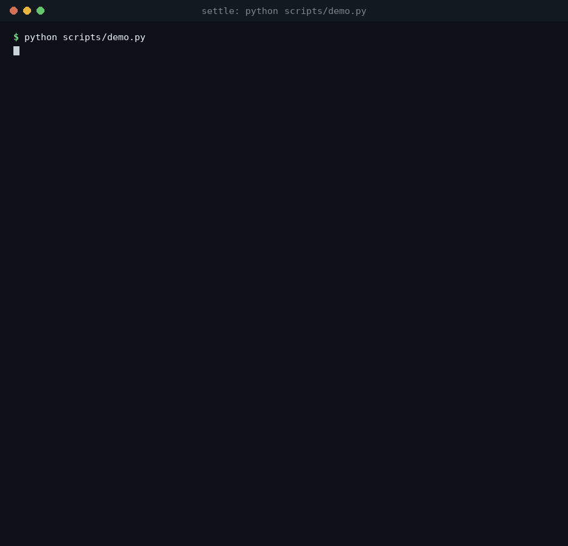
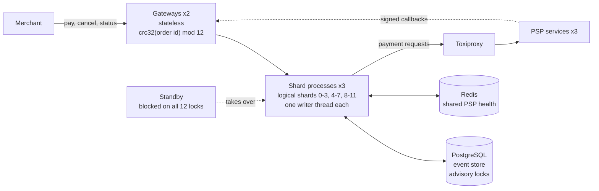
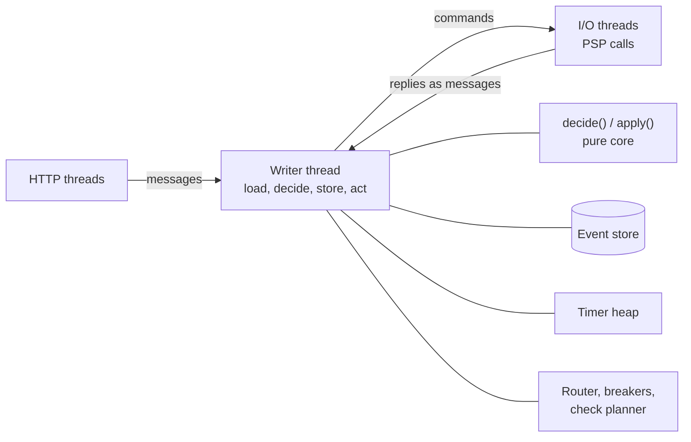
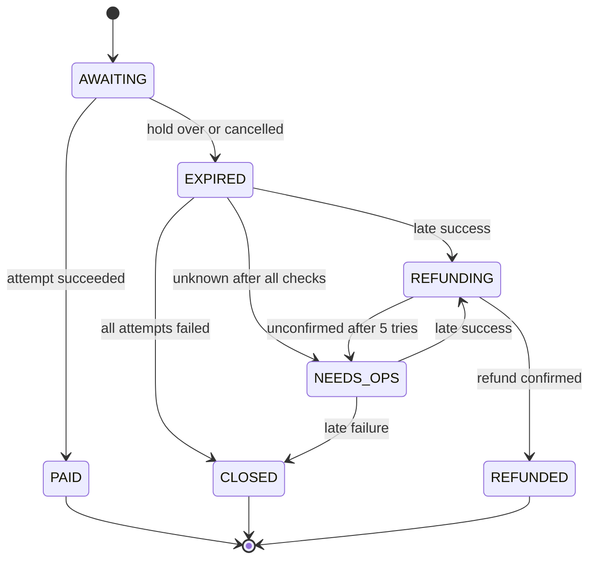

<h1 align="center">Settle</h1>

<p align="center">
  <b>Fault-tolerant UPI payment orchestration.</b><br>
  Every order ends paid exactly once, or not charged at all, inside NPCI's rules.
</p>

<p align="center">
  <a href="https://github.com/SrijaMalhar/Settle/actions/workflows/ci.yml"></a>
  <a href="https://github.com/SrijaMalhar/Settle/actions/workflows/system.yml"></a>
  
  
  
  
</p>

<p align="center">
  
</p>

Settle sits between a merchant and its UPI payment service providers (PSPs). It routes each payment to the PSP most likely to answer cleanly, tracks it through an explicit state machine, resolves "pending" payments with status checks that stay within NPCI's limits, and refunds automatically when money arrives after an order was given up.

It is a sharded service: stateless gateways in front of shard processes that each own a set of logical shards through a PostgreSQL advisory lock, with one writer thread per process, an event-sourced store, and a standby that takes over in milliseconds. All business rules live in one pure function. Correctness is checked by a deterministic simulator, property-based tests, real TCP fault injection, and chaos runs against the full Docker deployment on every code change.

| | |
|---|---|
| **Correctness** | 10,000 simulated runs, 400,000 orders, 8,804 injected crashes: **0 invariant violations** |
| **Failover** | standby holds the lock **2.2 ms** after `SIGKILL`; serving traffic **0.33 s** after `docker kill`, with **0 failed requests** |
| **Scaling** | **1.97x** throughput at 2 shards and **2.79x** at 3 on a fixed per-shard CPU budget; 218 payments/s on 4 vCPUs |
| **Chaos** | 6 fault scenarios on the real images, on every code change: **0 invariant violations** |
| **Replay** | **5,195 of 5,195** stored payment histories rebuilt exactly from their inputs |
| **Tests** | 113, against real PostgreSQL, Redis and Toxiproxy; `mypy --strict` |

[Problem](#problem) · [Guarantees](#guarantees) · [Architecture](#architecture) · [State machine](#state-machine) · [Routing](#routing-and-failure-attribution) · [Failover](#storage-and-failover) · [Observability](#observability) · [Verification](#verification) · [Getting started](#getting-started) · [API](#api) · [Design](#design-decisions)

---

## Problem

A customer pays by UPI and sees "pending". Nobody yet knows whether money left their account, and the merchant must decide whether to hand over the goods.

- **A timeout proves nothing.** The request may or may not have reached the PSP.
- **Answers arrive late, twice, or out of order.** Callbacks get lost, repeated, or beat the HTTP reply.
- **Orders expire.** A food order is held for about 10 minutes; a payment that succeeds after that must be refunded.
- **Not every failure is the PSP's.** A wrong PIN (`ZM`) or low balance (`Z9`) is the customer's; an acquirer timeout (`BT`) is the system's.
- **Status checks are rationed.** NPCI allows at most three, the first after 90 s, at least 90 s apart, within two hours, and none after a transport error.
- **Mistakes are expensive.** A failed-but-debited payment must be reversed by T+1, then compensated daily.

## Guarantees

| Guarantee | Enforced by | Verified by |
|---|---|---|
| No customer is charged twice for one order | At most one live attempt per order, checked in one place; a timeout is "unknown", never "failed" | Simulator I1, I5; Hypothesis state machine |
| An unpaid order ends with no money taken | A success after the order is given up becomes a refund, resent with the same id until confirmed | Simulator I2; chaos runs |
| NPCI's status-check rules are never broken | Every check plan is fitted to the rules; a check whose answer was lost in a crash counts as a transport error | Simulator I3; chaos runs |
| Settle's answer always matches the PSP's | A contradiction (failure after success) is never applied; both answers go to an ops queue | Simulator I6; chaos runs against PSP ledgers |
| A crash loses nothing and repeats nothing | Events are stored before any command runs; an in-flight send is treated as unknown and checked, never resent | Crash fault in every simulated run; recovery tests |
| One writer per shard, always | A PostgreSQL advisory lock per logical shard; writes only through the lock's connection; exit on connection loss | Failover tests; `docker kill` and `docker pause` chaos runs |

---

## Architecture



Gateways hash each order to one of 12 logical shards and forward to the process that currently owns it, read from `shard_owners`. Every endpoint is idempotent, so a request that hits a dead or moved owner is simply sent again. Callbacks are routed by the logical shard embedded in the attempt id.

### Inside a shard



Each shard process is an actor. One writer thread owns all payment state; HTTP and I/O threads only exchange messages with it, so no lock ever guards payment state. Each step loads a payment, calls `decide()`, appends the resulting events in one transaction, and only then runs the commands.

```python
decide(payment, input) -> (events, commands)   # no I/O, no clock, no randomness
apply(payment, event)  -> payment              # state is a fold over stored events
```

Time and the router's choice arrive with the input, so the same rules run unchanged in production, in the simulator, and in replay. There is no status column: state is rebuilt from events.

## State machine



A definite failure keeps the payment in `AWAITING` so the customer can pay again. A PSP that contradicts itself sends the payment to `NEEDS_OPS` from any state. Each attempt has its own five-state machine, defined as a transition table in [`model.py`](settle/core/model.py):

| From | Signal | To |
|---|---|---|
| `SENDING` | `accepted`, `read_timeout`, `deemed`, `recovered` | `PENDING` |
| `SENDING` | `not_delivered`, `declined`, `failure` | `FAILED` |
| `SENDING`, `PENDING`, `UNRESOLVED` | `success` | `SUCCEEDED` |
| `PENDING`, `UNRESOLVED` | `failure` | `FAILED` |
| `PENDING` | `checks_exhausted` | `UNRESOLVED` |

A duplicate answer is a no-op; any move not in the table raises `IllegalMove`.

## Routing and failure attribution

Every failure is attributed from its NPCI response code before it counts against a PSP:

| Caused by | Codes | Counts against the PSP |
|---|---|---|
| Customer | `ZM` `Z6` `Z9` `ZA` `U69` `ZH` | No |
| Customer's bank | `Z7` `Z8` `U30` `U67` `UT` | No |
| PSP side | `BT` `U28` `RB`, timeouts, refused connections | Yes, and trips its breaker |

The router optimises for **clean** successes: a success that left the customer at "pending" counts as a fraction `w` (default 0.5). It picks a PSP by Thompson sampling over each PSP's last minute of outcomes, kept in 10-second buckets in Redis so every shard learns from every other. A PSP's circuit breaker opens after five PSP-side failures in a row, is shared through a self-expiring Redis key, and lets one trial through after 30 s. If Redis is down, shards fall back to local buckets they keep warm.

An order may move to a second PSP only when the first provably never received the request. Measured with Toxiproxy against a PSP that logs every request it receives:

| Network fault | PSP received it | Verdict |
|---|---|---|
| Connection refused | No | Not delivered: safe to retry elsewhere |
| Slow reply (3 s latency, 1 s timeout) | **Yes** | Unknown: check status |
| Reset after sending | **Yes** | Unknown: check status |
| Black hole | No, but indistinguishable | Unknown: check status |

**Status checks.** A pending attempt gets at most three checks, timed from that PSP's answer-time distribution (its 50th, 80th and 95th percentiles, the last never before 540 s) and fitted to NPCI's rules. Answer times are learned only from callbacks and replies, never from checks, which only show when Settle found out.

## Storage and failover

- **Events** are append-only, keyed by `(payment_id, seq)`, so a second writer fails on the primary key instead of interleaving.
- **Inputs** are stored with each batch of events, so histories can be re-run through changed rules (`python -m settle.replay`).
- **Ownership** is a PostgreSQL advisory lock per logical shard, held on a dedicated connection that carries every write for that shard. When the owner dies, its session ends and the lock frees; the standby's blocked lock call returns, it rebuilds open payments and timers from events, and publishes itself to the gateways. An owner that loses its connection exits rather than reconnecting.
- **Bulkheads**: gateways share one bounded connection pool and allow 24 in-flight requests per owner, so a frozen shard slows only its own customers.

## Observability

Every shard and gateway exposes Prometheus metrics; Prometheus discovers them through Docker DNS, and Grafana loads a provisioned dashboard. Counters are fed by an observer on stored events; state gauges are refreshed by the writer thread. Five alert rules ship with it; the paging rule for a logical shard without an owner is unit-tested with `promtool`, and fired 21 s after a shard was killed with no standby running.

<p align="center">
  
</p>
<p align="center"><sub>Captured by CI immediately after the chaos runs: traffic leaving a slowed PSP, breakers opening, checks following pending spikes, and ownership moving when a shard is killed.</sub></p>

| Metric | Shows |
|---|---|
| `settle_attempts_total{psp}` | Routing decisions |
| `settle_attempt_outcomes_total{psp,outcome,blame}` | Clean and pending successes; failures by cause |
| `settle_time_to_certainty_seconds{psp}` | Send to final answer, for attempts that went pending |
| `settle_status_checks_total{psp}` | NPCI check budget spent |
| `settle_breaker_state{psp}` | Closed, half open, open |
| `settle_live_attempts`, `settle_needs_ops_payments` | Money still in flight; payments awaiting a person |
| `settle_owned_logical_shards`, `settle_step_seconds` | Ownership and writer load per process |
| `settle_gateway_request_seconds{route}`, `settle_gateway_shed_total` | Edge latency and shed load |

---

## Verification

Simulator, experiments and process-level failover ran on a 2-vCPU VM. Chaos, replay and load results come from the [`system`](.github/workflows/system.yml) workflow on a 4-vCPU GitHub Actions runner, which builds the images, runs `docker compose up`, and repeats all of it on every code change. PSPs are mock services with synthetic profiles; network faults and process kills are real. Raw results are in [`results/`](results/).

### Deterministic simulation

The production engine runs single-threaded against PSPs that know the ground truth, with a fake clock and a different fault mix per seed: lost, duplicated and reordered callbacks, refused connections, resets, black holes, check transport errors, lost refund replies, PSP outages, self-contradicting PSPs, and crashes between storing and acting.

| Invariant | Result over 10,000 seeds |
|---|---|
| I1 Per order, money taken minus refunded is between 0 and one payment | 0 violations |
| I2 Once faults stop, each order is charged exactly when it was paid | 0 violations |
| I3 NPCI status-check rules hold | 0 violations |
| I4 Only legal transitions; final states never change | 0 violations |
| I5 At most one live attempt per order, in Settle and at the PSPs | 0 violations |
| I6 Settle's answer matches the PSP's; no debit unknown to Settle | 0 violations |
| I7 Same seed, same trace hash | 300 of 300 |

438,971 attempts, 285,378 status checks, 8,804 crashes, in 79 s. Seven classic payment bugs are planted behind flags, and each is caught:

| Planted bug | Caught by |
|---|---|
| Timeout treated as failure | I1, I5, I6 |
| Resend after timeout instead of a status check | I1, I2, I5, I6 |
| Duplicate success callback processed twice | I4 |
| First status check at 30 s | I3 |
| Late success never refunded | I2 |
| PSP called before the attempt is stored | I2, I6 |
| One-live-attempt check removed | I1, I4, I5 |

### Failover

| Scenario | Result |
|---|---|
| Owner killed (`SIGKILL`) | Standby took over in **2.2 ms**; the old owner never wrote again |
| Owner frozen (`SIGSTOP`, 2 s) | No takeover: the session stayed alive, so the lock did too |
| Owner's database session terminated | Next write failed, process exited; standby took over in **5.7 ms** |

### Chaos

Full deployment, 30 payments/s through both gateways, one 20-second fault per run, then I1 and I3 to I6 checked over the event log against each PSP's own ledger. Faults target whichever PSP is carrying traffic at the time.

| Fault | Result |
|---|---|
| PSP slowed (5 s latency) | 92 attempts went unknown, all resolved; the PSP's share of new attempts fell from 219 of 306 to 0; no errors, p95 8.8 ms |
| PSP down | Breaker open on every shard within **0.03 s**; no requests sent to it afterwards; no errors |
| Connection resets after sending | 38 attempts went unknown, all resolved; no request was ever sent twice |
| `docker kill` a shard | Standby serving its logical shards in **0.33 s**; 30 payments/s throughout; **0 errors** |
| `docker pause` a shard for 10 s | Owner unchanged; its own customers waited or were shed (70 of 96 requests failed); **all other shards: 0 errors, p95 9.3 ms** |
| Redis stopped | **0 errors**, p95 9.9 ms |

Afterwards each PSP replayed its final statuses, as a settlement file would, and I2 held: **5,195 payments, 4,221 paid, 497 closed, 476 refunded**, each charged exactly when paid. One payment still unknown at the end sat in the ops queue with no money taken.

### Load

Locust, 64 concurrent merchants, 60 s per layout, 4 vCPUs shared with the whole stack. Completed payments exclude requests shed with 503.

| Shard processes | Uncapped | p95 | 0.5 CPU per shard | Scaling | p95 |
|---|---|---|---|---|---|
| 1 | 163 /s | 640 ms | 72 /s | 1.00x | 960 ms |
| 2 | 191 /s | 770 ms | 142 /s | **1.97x** | 900 ms |
| 3 | 218 /s | 550 ms | 202 /s | **2.79x** | 690 ms |

Uncapped, extra shards mostly redistribute the same four cores. With every shard on the same CPU budget, capacity grows almost linearly because shards share nothing; the curve bends at three as the host runs out of CPU. Runners vary between runs; the shape holds.

### Experiments

**Pending weight `w`** (30,000 payments at 50/s): `w = 0.5` cut payments that went pending by **4.9x** for 1.8% fewer eventual successes, and completed the most orders if 30% of customers abandon a pending payment.

| `w` | Went pending | Eventual successes | Completed at 30% abandonment |
|---|---|---|---|
| 1.0 (success rate) | 2,735 | 27,652 | 26,889 |
| **0.5** | **555** | 27,156 | **26,999** |
| 0.0 (clean only) | 388 | 27,062 | 26,954 |

**Status-check planner** (30% of callbacks lost): on a slow PSP the percentile plan resolved **88.5%** of lost callbacks versus 79.4% for the fixed plan, sent 42% fewer payments to ops, and spent 37% fewer checks, at the cost of certainty arriving 30 s later on average. On fast and long-tailed PSPs the two plans are equivalent.

### Defects found by the test suite

1. **Illegal status check after a crash** (simulator). A check hit a transport error and the process crashed before seeing it; the restarted process checked again. Fixed by storing every "still pending" answer, so recovery can tell a lost answer from a received one.
2. **Long-tailed PSPs sent to ops** (planner experiment). A last check at the 95th percentile came 4 minutes earlier than the fixed plan's, and 4x as many lost callbacks went to ops. The last check now never precedes the fixed plan's.
3. **504s with no fault injected** (first chaos run). Per-thread keep-alive sessions exhausted each shard's connection limit. Fixed with one shared, bounded pool.
4. **A frozen shard starved healthy ones** (freeze run). Forwards to the paused shard held every gateway thread (p95 4 s elsewhere). Fixed with per-owner bulkheads.
5. **Double charge in two steps** (Hypothesis). With the live-attempt check removed, the state-machine test fails in under a second and shrinks to `pay`, `pay`.

---

## Getting started

Requires Docker with Compose v2. Python 3.12 is only needed for the tests and tools.

```bash
docker compose up -d --build

KEY='authorization: Bearer dev-merchant-key'
curl -X POST localhost:8000/orders/order-1/pay -H "$KEY" -H 'content-type: application/json' -d '{"amount": 49900}'
curl -H "$KEY" localhost:8001/orders/order-1     # any gateway serves any order
```

| Service | URL |
|---|---|
| Gateways | `localhost:8000`, `localhost:8001` |
| Grafana (anonymous, read-only) | `localhost:3000` |
| Prometheus | `localhost:9090` |
| Toxiproxy API | `localhost:8474` |

```bash
pip install -e ".[dev,load]"
mypy && pytest                                   # starts throwaway PostgreSQL, Redis, Toxiproxy if installed
python scripts/demo.py                           # the three payments above
python -m sim.run seeds --count 10000            # also: determinism, bugs, router, planner

SETTLE_HOLD_SECONDS=60 docker compose up -d --build
python scripts/smoke.py                          # end-to-end check of a running stack
python -m chaos.run_all                          # six fault scenarios with invariant checks
python -m loadtest.run --shard-cpus 0.5          # 1, 2 and 3 shard processes
docker compose exec shard-1 python -m settle.replay
```

Machines without registry access can run every service except Grafana with [`deploy/local/`](deploy/local/).

## API

Merchant endpoints require `Authorization: Bearer <key>` (`SETTLE_MERCHANT_KEYS`). PSP callbacks are authenticated by an HMAC signature verified at the shard.

| Method | Path | Behaviour |
|---|---|---|
| `POST` | `/orders/{id}/pay` | Creates the payment or starts a new attempt (`202`). `409` with the next check time while an earlier attempt may still succeed; `200` unchanged if already paid. |
| `POST` | `/orders/{id}/cancel` | Gives up the order; a later success is refunded. |
| `GET` | `/orders/{id}` | Status, attempts, refunds, next status check. |
| `POST` | `/psp/{psp}/callback` | Signed PSP result; duplicates are no-ops. |
| `GET` | `/stats` | Per-PSP score, breaker and check plan; ops queue. |
| `GET` | `/metrics` | Prometheus metrics. |

## Project structure

```
settle/
  core/           pure domain: money, state tables, messages, decide()/apply()
  policies/       routing and blame, circuit breaker, status-check planners
  adapters/       PostgreSQL and in-memory stores, Redis and local health, PSP client
  shard/          writer engine, timers, advisory-lock ownership, HTTP server
  gateway.py      shard routing, retries, bulkheads, merchant auth
  mockpsp.py      PSP simulator: NPCI codes, signed callbacks, ground-truth ledger
  metrics.py      Prometheus instrumentation
  replay.py       re-run stored histories through new rules
sim/              deterministic simulator, invariants, experiments
chaos/            fault scenarios and live invariant checks
loadtest/         Locust scenarios and shard-layout runner
tests/            113 tests
deploy/           schema, Prometheus, alert rules and tests, Grafana, Toxiproxy
scripts/          demo, smoke test, dashboard screenshot, demo GIF
```

## Design decisions

- **Functional core, imperative shell.** All rules in a pure `decide()`; the engine only performs I/O. The same code runs in production, simulation and replay.
- **Actor per shard.** One writer thread owns state; concurrency is message passing, not locks.
- **Event sourcing with stored inputs.** Full audit history, crash recovery by replay, and safe what-if analysis of rule changes.
- **Ports and adapters.** The core depends on five interfaces; PostgreSQL, Redis and HTTP are swappable adapters.
- **Transition tables over state classes.** Every legal move is visible in one place, and illegal ones raise.
- **Advisory locks over Redis or ZooKeeper leases.** The lock lives on the same connection as the writes, so a process that loses it cannot keep writing; no fencing tokens or clock assumptions are needed.
- **Crash-only components.** A shard that loses its database connection exits; recovery is the same code path as startup.

## Limitations

- PSPs are simulated; there is no integration with a real PSP sandbox.
- Single merchant, full payments and full refunds only.
- Runs on a single Docker host; no TLS termination or secret manager.
- Scaling path: more logical shards across more processes, monthly partitions of the event table, a read replica for queries, and separate database clusters per shard group.
