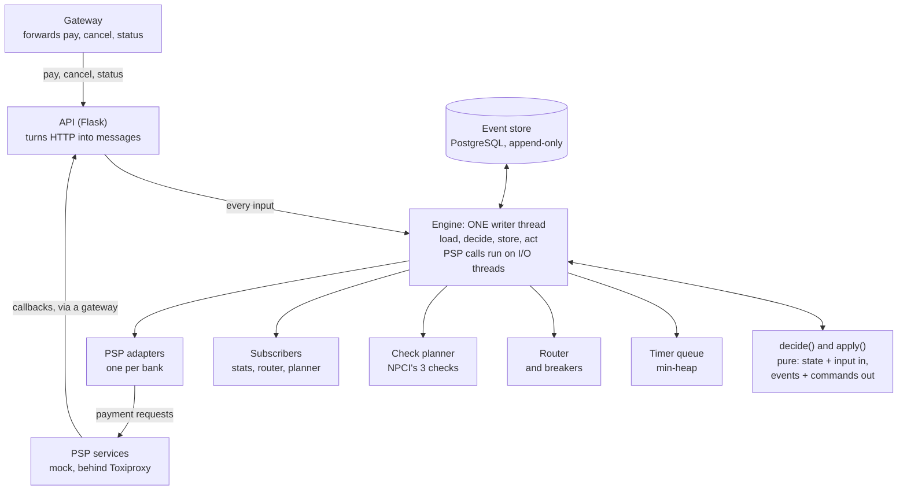
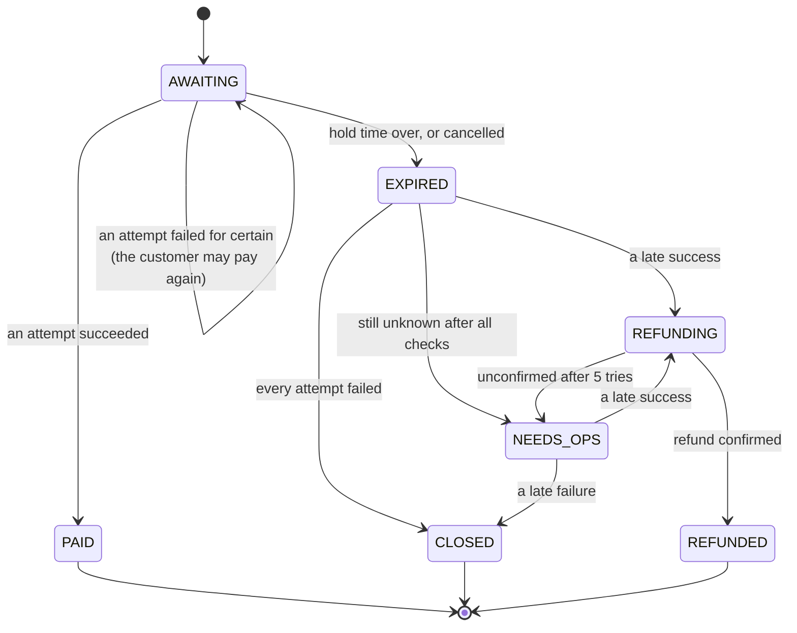
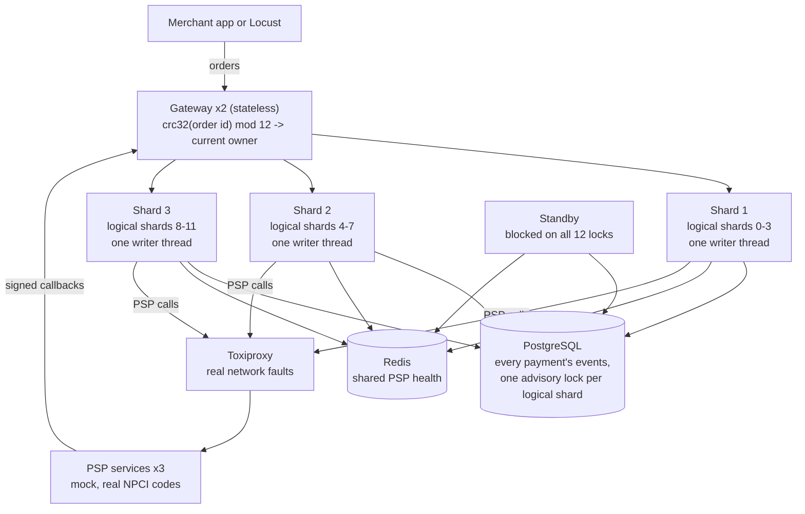
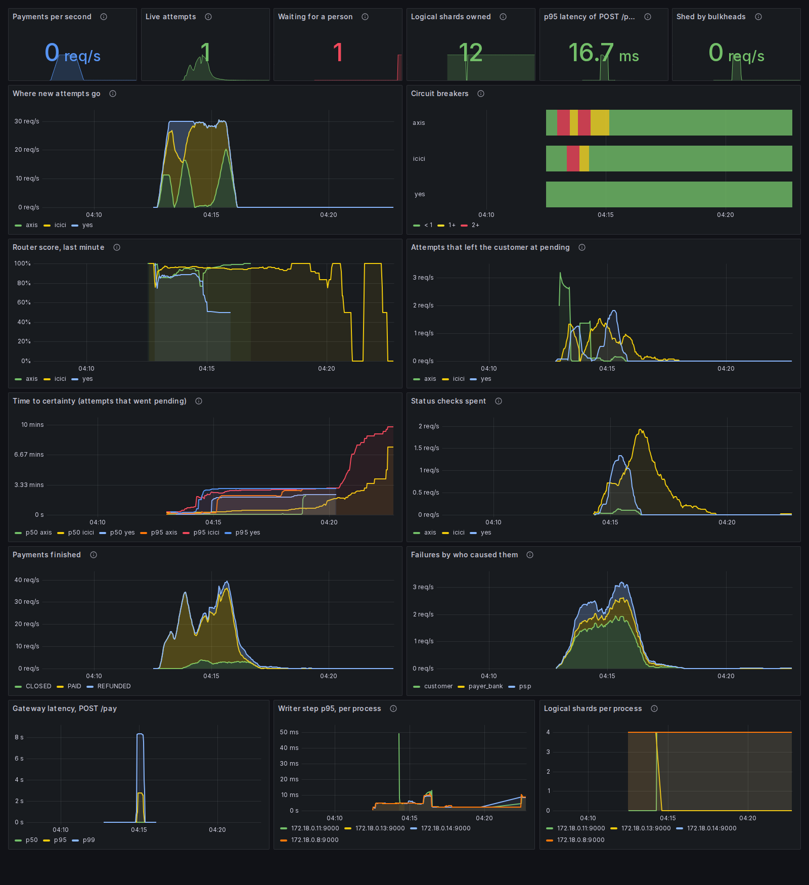

# Settle

A UPI payment orchestrator for one merchant. It routes each payment to the PSP most likely to give a clean answer, tracks every payment through a strict state machine, resolves "pending" payments within NPCI's status-check limits, and refunds automatically when money arrives after the order was given up.

It runs as stateless gateways in front of shard processes, each with a single writer thread, backed by PostgreSQL and Redis, with a standby that takes over when a shard dies. Every business rule lives in one pure function, `decide()`, and the whole system is tested three ways: a deterministic simulator, property-based tests, and real network faults and process kills in Docker.

**One job:** every order ends in exactly one clean outcome, paid once or not charged at all, as fast as NPCI's rules allow.

| | |
|---|---|
| Stack | Python 3.12, Flask, PostgreSQL 16, Redis, Docker Compose, Toxiproxy, Prometheus, Grafana, Locust, pytest, Hypothesis, mypy (strict) |
| Tests | 113, against a real PostgreSQL, Redis and Toxiproxy, plus real process kills; alert rules unit-tested with `promtool` |
| Every push | GitHub Actions builds the images, runs `docker compose up`, a smoke test, the six chaos runs, the replay check and the load tests ([latest run](https://github.com/SrijaMalhar/Settle/actions/runs/43675627388)) |
| Simulator | 10,000 seeds, 400,000 orders, 8,804 injected crashes: **0 invariant violations** |
| Failover | standby takes over **2.2 ms** after `SIGKILL` (process level); serving the dead shard's traffic **0.33 s** after `docker kill` |
| Chaos | six runs on the official images under load: **0 invariant violations**; merchant errors only for the frozen shard's own customers |
| Load | 163 / 191 / 218 payments per second at 1 / 2 / 3 shard processes on 4 vCPUs; with each shard held to 0.5 CPU, **72 / 142 / 202 (1 : 1.97 : 2.79)** |
| Replay | all **5,195** stored histories from the chaos run re-run through `decide()` came out identical |

---

## The problem

A customer pays by UPI and sees "payment pending". Nobody yet knows whether the money left their account, and the merchant has to decide whether to hand over the food.

- **A timeout says nothing.** The request may or may not have reached the PSP.
- **Answers arrive late, twice, or out of order.** A callback can be lost, repeated, or beat the HTTP reply.
- **The merchant can't wait forever.** A food order is held for about 10 minutes. If the payment succeeds after that, the customer has paid for nothing and must be refunded.
- **PSPs go down,** and not every failure is the PSP's fault. NPCI separates technical declines from business declines (OC-149A): a wrong PIN (`ZM`) or low balance (`Z9`) is the customer's; an acquirer timeout (`BT`) is the system's.
- **Asking is rationed.** NPCI's 2025 rules (UPI-OC-215): the first status check only 90 s after the transaction, at most three within two hours, at least 90 s apart, and none after a transport error.
- **Mistakes cost money.** RBI requires a failed-but-debited transaction to be reversed by T+1, then ₹100 a day in compensation.

## Six guarantees

1. No customer is charged twice for one order.
2. Once the PSP's answer is known, every order that isn't paid ends with the customer's money returned or never taken.
3. Settle never breaks NPCI's status-check rules.
4. Settle's final answer for an attempt always matches the PSP's.
5. A crash at any moment loses nothing and repeats nothing.
6. When a shard dies, its standby takes over, and two processes never write the same shard at once.

### The eight rules they follow from

1. **A timeout means "unknown", never "failed".** Only the PSP can say a payment failed.
2. **One live attempt per order.** A second attempt starts only after the first has definitely failed. This makes guarantee 1 true by construction.
3. **Ask, never resend.** An unknown payment is resolved by asking its status. Refunds are the one exception: PSPs deduplicate them by refund id.
4. **Decide in one place.** Every business rule lives in `decide()`. Everything else carries messages in and out.
5. **Write before you act.** "Attempt started" is stored before the PSP is called, so a crash can never lose track of a request.
6. **One writer per shard, enforced by the database.** A process writes a logical shard only while it holds that shard's PostgreSQL advisory lock, and only through the connection that holds it. If that connection is lost, the process exits instead of reconnecting.
7. **Blame correctly.** Every failure is attributed (customer, customer's bank, or PSP) from its NPCI code before it counts against a PSP.
8. **Escalate, don't guess.** A payment still unknown after the checks run out goes to an ops queue. Settle never marks it failed.

---

## Architecture: inside one shard



A shard is one process. Every input (a pay request, a PSP reply, a callback, a status-check result, a timer) goes through the engine's single writer thread, which stores events before it acts. HTTP threads and I/O threads never touch payment state: they put messages in the writer's inbox and get answers back through futures, so the application code has no locks.

**One payment, end to end**

1. The merchant calls `POST /orders/{order_id}/pay` on any gateway. The gateway hashes the order id to one of 12 logical shards (`crc32 mod 12`) and forwards the call to the process that owns it.
2. The writer loads the payment's events, asks the router for the best PSP, and calls `decide()`.
3. `decide()` returns the event `AttemptStarted` and the command `SendToPsp`. The writer stores the event first, then hands the PSP call to an I/O thread and moves on.
4. The customer approves in their UPI app and the PSP's signed callback reaches a gateway, which forwards it to the owning shard (the logical shard is part of the attempt id).
5. `decide()` returns `PaymentPaid` and `Notify`. The writer stores the event, then tells the merchant to fulfil the order.

### The decision core

```python
decide(payment, input) -> (events, commands)   # no database, no network, no clock, no randomness
apply(payment, event) -> payment               # state = apply(...apply(apply(None, e1), e2)..., en)
```

The time and the router's choice come in with the input. Because the core is pure, it is tested with no mocks, the simulator and production run exactly the same rules, and any payment can be rebuilt from its events and replayed. There is no status column anywhere: a payment's status is computed by replaying its events (event sourcing).

## Payment lifecycle



`PAID`, `CLOSED` and `REFUNDED` are final. From any state, a PSP that contradicts itself (failure after success) sends the payment to `NEEDS_OPS` with both answers stored; the contradiction is never applied.

Each attempt (one request to one PSP) has five states, and every legal move is a row in one table ([`settle/core/model.py`](settle/core/model.py)):

| From | Signal | To |
|---|---|---|
| `SENDING` | `accepted`, `read_timeout`, `deemed` (RB), `recovered` | `PENDING` (unknown, never failed) |
| `SENDING` | `not_delivered` (connection refused), `declined`, `failure` | `FAILED` |
| `SENDING`, `PENDING`, `UNRESOLVED` | `success` | `SUCCEEDED` |
| `PENDING`, `UNRESOLVED` | `failure` | `FAILED` |
| `PENDING` | `checks_exhausted` | `UNRESOLVED` |

`move()` returns the same status for a duplicate answer and raises `IllegalMove` for a contradiction, so neither can slip through. `SENDING`, `PENDING` and `UNRESOLVED` are live: the attempt might still take money, and a payment may have at most one live attempt.

## Routing and circuit breakers

Settle sends each new attempt to the PSP most likely to give a **clean** success: approved and confirmed through the normal path, with no timeout, no deemed answer and no status check. It changes what is measured, compared with plain success-rate routing:

1. **Blame correctly.** Failures are attributed from NPCI codes first, and only PSP-side failures count against a PSP or trip its breaker.

   | Who caused it | NPCI codes | Counts against the PSP? |
   |---|---|---|
   | The customer | `ZM` wrong PIN, `Z6` PIN tries, `Z9` funds, `ZA` declined, `U69` collect expired, `ZH` bad UPI ID | No |
   | The customer's bank | `Z7`, `Z8` limits, `U30` debit failed, `U67` debit timeout, `UT` bank down | No |
   | The PSP side | `BT`, `U28`, `RB` deemed, Settle's own timeouts and refused connections | Yes, and trips the breaker |

2. **Price uncertainty.** A success that left the customer at "pending" counts as a fraction `w` of a clean one (`w = 1` is plain success-rate routing).

The router uses **Thompson sampling**: one draw from `Beta(1 + good, 1 + bad)` per healthy PSP over its last minute of PSP-attributable outcomes, highest draw wins. Health lives in **Redis** in 10-second buckets that every shard reads, so one shard's bad minute protects all of them; an open breaker is a Redis key that expires after 30 s, and the next attempt after that is the half-open trial. If Redis is down, every shard falls back to the same buckets it has kept locally all along.

**When may an order go to a second PSP?** Only when the first never received the request. Tested with Toxiproxy injecting real TCP faults between Settle and a mock PSP that records every request it receives ([`tests/test_toxiproxy.py`](tests/test_toxiproxy.py)):

| Fault injected | Did the PSP receive it? | Settle's verdict |
|---|---|---|
| PSP down (connection refused) | No | Not delivered: another PSP is safe |
| Slow reply (3 s latency, 1 s read timeout) | **Yes** | Unknown: check its status |
| Connection reset after the request was sent | **Yes** | Unknown: check its status |
| Black hole (data silently dropped) | No, but Settle can't know that | Unknown: check its status |

A reset or a timeout is not proof that the request didn't arrive. Only a failure before the connection opened is.

## Status checks under NPCI's limits

A pending attempt gets at most three status checks, timed from that PSP's own history. Callbacks normally arrive first; checks are the safety net for a lost callback.

- `FixedPlanner`: 90, 270 and 540 s (the common fixed backoff, the baseline).
- `PercentilePlanner`: the last 500 answer times for that PSP; checks at the 50th and 80th percentiles, and the last check at the 95th but never earlier than the fixed plan's last (see [What the tests caught](#what-the-tests-caught)). Every time is moved later if NPCI's rules need it. Fewer than 50 samples: the fixed plan.

Answer times are learned only from callbacks and the PSP's own replies, because a status check or settlement file only says when Settle *found out*. If a check hits a transport error, Settle stops checking that attempt, as NPCI directs, and waits for a callback, then ops.

## Storage, crash recovery and failover

Each step: load the payment's events, call `decide()`, append the new events **in one transaction through the shard lock's connection**, and only then run the commands. If Settle crashes between storing and sending, the restarted process can't tell whether the request went out, so it treats the attempt as unknown and checks its status. It never resends.



Ownership is decided by a lock, not a table. A process owns logical shard *k* only while it holds `pg_advisory_lock(5150, k)` on a connection dedicated to that shard, and every write for shard *k* goes through that connection. PostgreSQL releases a session's advisory locks when the session ends, which makes failover automatic: kill the owner and its socket closes, its locks are freed, and the standby's blocked lock call returns. The new owner rebuilds every open payment and its timers from events, then publishes itself in `shard_owners` so gateways route to it.

Gateways share one bounded connection pool and give each owner a **bulkhead** of 24 requests in flight, so a frozen or overloaded shard slows only its own customers.

## Observability

Every shard process and gateway serves `/metrics`. Prometheus finds them through Docker's DNS, the standby and both gateway replicas included, and Grafana opens on a provisioned dashboard at `localhost:3000`. Counters come from an observer on stored events, so nothing in `decide()` knows about metrics; gauges for breakers, router scores and live attempts are refreshed by the writer thread itself, since only it may read payment state.

The screenshot was taken by the CI run straight after the six chaos runs, so it shows them. Traffic leaves `axis` the moment it slows and moves to `icici`, then away from `icici` when it goes down. Breakers flash red and yellow on the timeline. Payments left at "pending" spike during the slow and reset runs, and status checks follow 90 seconds later as those payments are checked. The bottom-right panel shows logical-shard ownership changing when shard-2 is killed, and the one spike in gateway latency is the frozen shard's own customers waiting during its pause.



Prometheus also carries [alert rules](deploy/alerts.yml), unit-tested with `promtool` in CI: a logical shard without an owner for 15 seconds pages someone (with no standby, it fired 21 seconds after a shard was killed; with the standby running it never fires, because the takeover finishes in under a second); a breaker open for two minutes, payments waiting for a person, too many payments left at pending, and gateways shedding load raise tickets.

| Metric | What it shows |
|---|---|
| `settle_attempts_total{psp}` | Where the router sends new attempts |
| `settle_attempt_outcomes_total{psp,outcome,blame}` | Clean successes, pending successes and failures, with who caused each failure |
| `settle_attempts_went_pending_total{psp}` | Customers left looking at "pending" |
| `settle_time_to_certainty_seconds{psp}` | From sending to a final answer, for attempts that went pending |
| `settle_status_checks_total{psp}` | Checks spent against NPCI's budget |
| `settle_breaker_state{psp}`, `settle_router_score{psp}` | Breakers (0 closed, 1 half open, 2 open) and the router's view of each PSP |
| `settle_live_attempts`, `settle_needs_ops_payments` | Money that might still move, and payments waiting for a person |
| `settle_owned_logical_shards`, `settle_step_seconds`, `settle_inbox_depth` | Ownership per process, and how busy each writer thread is |
| `settle_gateway_request_seconds{route}`, `settle_gateway_shed_total` | Latency at the edge, and load shed by the bulkheads |

## Replay check

Every batch of events is stored with the input that caused it, in the same transaction (the `inputs` table). `python -m settle.replay` feeds those inputs back through `decide()`, either today's or a changed one (`--decide module:function`), and lists every payment whose outcome would change: its status, and the money that would be refunded.

With today's rules every history must rebuild exactly. After the CI chaos run, all 5,195 did, and the simulator's histories do too, crashes and PSP contradictions included. With a planted bug switched on (`--bugs no_refund_after_expiry`), it lists the late successes that would never have been refunded. That is the check to run before changing a rule that touches money.

One limit: an input that changed nothing (a duplicate callback, a refused second tap) stores no events, so no input either, and a new rule that would act on one of those cannot be judged by replay.

---

## Results

Everything below was measured. The simulator, the experiments and the process-level failover tests ran on a 2-vCPU Linux VM (Ubuntu 24.04, Python 3.13, PostgreSQL 16.15, Redis 7.0, Toxiproxy 2.9.0). The chaos runs, the replay check and the load tests ran on a GitHub Actions runner (4 vCPUs, AMD EPYC 7763, 16 GB) against the images `docker compose up --build` builds and pulls, in the [`system` workflow](https://github.com/SrijaMalhar/Settle/actions/runs/43675627388), which repeats them on every push. The PSPs are mock services with made-up profiles, so the routing and planning numbers describe those profiles, not any real bank. Raw results are in [`results/`](results/) (the runner's in [`results/ci/`](results/ci/)).

### Simulator: 10,000 seeds

The real `PaymentEngine` runs on one thread with a fake clock against mock PSPs that know the truth (what they really took and gave back). Every seed draws a different fault mix, from calm to hostile: lost, repeated and reordered callbacks, refused connections, resets after sending, black holes, transport errors on checks, lost refund replies, PSP outages, PSPs contradicting themselves, and a crash fault that throws the engine's memory away between storing and acting.

| Check | What it means | Result |
|---|---|---|
| I1 | Per order, money taken minus refunded is between 0 and one payment | 0 violations |
| I2 | Once faults stop, every order is charged exactly when it was paid | 0 violations |
| I3 | NPCI: at most 3 checks, first after 90 s, 90 s apart, within 2 h, none after a transport error | 0 violations |
| I4 | Only legal transitions; final states never change | 0 violations |
| I5 | At most one live attempt per order, in Settle's view **and** at the PSPs | 0 violations |
| I6 | Settle's final answer matches the PSP's truth; no debit is unknown to Settle | 0 violations |
| I7 | The same seed gives the same trace hash | 300 of 300 seeds |

10,000 seeds, 400,000 orders, 438,971 attempts, 285,378 status checks, 8,804 crashes, 79 s on 2 cores (`python -m sim.run seeds --count 10000`).

**Every planted bug is caught.** Each classic payment bug sits behind a flag; with it on, the checks must fail (`python -m sim.run bugs`):

| Planted bug | Caught by |
|---|---|
| A read timeout treated as a failure, so the customer pays again | I1, I5, I6 |
| The payment resent after a timeout instead of a status check | I1, I5 |
| A duplicate success callback processed as new | I4 |
| A first status check 30 s after sending | I3 |
| A success after expiry never refunded | I2 |
| The PSP called before "attempt started" is stored, then a crash | I6, I2 |
| The one-live-attempt check removed | I5, I1, I4 |

### Router weights

30,000 payments at 50 a second, one attempt each (`python -m sim.run router --count 30000`). PSP `axis` ends in success most often but sends about 9% of payments through a timeout first; `icici` succeeds a little less in the end but almost never leaves anyone waiting.

| Weight `w` for a success that went pending | Payments that went pending | Eventual successes | Completed if 30% abandon a pending payment |
|---|---|---|---|
| 1.0 (plain success rate) | 2,735 | 27,652 | 26,889 |
| **0.5 (default)** | **555** | 27,156 | **26,999** |
| 0.0 (clean successes only) | 388 | 27,062 | 26,954 |

`w = 0.5` sent **4.9 times fewer** payments through "pending" for 1.8% fewer eventual successes, and completed the most orders under the 30% abandonment assumption. That 30% is an assumption, which is why `w` is the merchant's setting.

### Status-check planner

Callbacks lost 30% of the time; of those attempts, how many a status check resolves before ops, and how long until Settle knows (`python -m sim.run planner --count 4`, about 2,400 lost callbacks per row):

| PSP profile | Planner | Resolved by a check | Sent to ops | Mean time to certainty | Checks spent |
|---|---|---|---|---|---|
| fast (answers in about 20 s) | fixed | 100% | 0 | 95.6 s | 2,638 |
| | percentile | 100% | 0 | 94.1 s | 2,681 |
| slow (median about 5.5 min) | fixed | 79.4% | 497 | 388.8 s | 16,708 |
| | **percentile** | **88.5%** | **286** | 419.1 s | **10,463** |
| flaky (long tail) | fixed | 98.6% | 34 | 155.8 s | 6,270 |
| | percentile | 98.6% | 35 | 152.8 s | 6,858 |

On the slow PSP the percentile plan sends 42% fewer payments to ops and spends 37% fewer checks, but certainty comes about 30 s later on average, because it does not waste a check at 90 s when almost no answers exist yet. On the fast and flaky PSPs the two plans are close.

### Failover (real PostgreSQL, process level)

| Experiment | What happened |
|---|---|
| Owner killed with `SIGKILL` (what `docker kill` sends) | Standby took over in **2.2 ms**; the old owner never wrote again |
| Owner frozen with `SIGSTOP` for 2 s (like `docker pause`) | No takeover: its session was alive, so it kept the lock and carried on when it woke |
| Owner's database session cut while it ran | Its next write failed and it **exited**; the standby took over in 5.7 ms |

### Chaos runs in Docker

All services in Docker Compose on the official images, payments arriving at 30 per second through both gateways, one fault per run for 20 seconds, then I1 to I6 over the event log against the PSPs' ledgers (`python -m chaos.run_all`). Each PSP fault targets whichever PSP is carrying traffic at that moment, because the router moves traffic off a misbehaving PSP so quickly that a fault aimed at one it had already left would test nothing.

| Run | Fault | What must hold | Measured |
|---|---|---|---|
| A PSP turns slow | 5 s latency toxic on the busiest PSP (`axis`) | Its payments go unknown and checks resolve them; the router moves new traffic away | 92 attempts timed out and went unknown, all later resolved. `axis` went from 219 of 306 new attempts in the 20 s before to **0** in the second half of the fault. 0 merchant errors, p95 8.8 ms |
| A PSP goes down | The busiest PSP's proxy disabled (`icici`) | Its breaker opens on every shard; traffic moves | The requests in flight were cut (unknown, checked later), and those PSP-side failures opened its breaker on all three shards within **0.03 s**. One new request was refused; none was sent after the breakers opened. 0 errors |
| Resets mid-request | `reset_peer` after the request went out, on the busiest PSP (`axis`) | Every reset attempt is checked; none is resent | 38 attempts reset and went unknown, all resolved; no PSP received any attempt twice |
| Kill a shard under load | `docker kill shard-2` | The standby takes over; nobody is charged twice | The standby was serving logical shards 4 to 7 **0.33 s** after the kill, recovery included. 30 payments/s before and after, **0 errors**; the dead shard's own customers waited (p95 611 ms in the first 5 s) but none failed |
| Freeze a shard | `docker pause shard-1` for 10 s | No second writer; its customers wait | The owner never changed. The frozen shard's own customers waited or were shed (70 of 96 got 504/503, p95 4.9 s); **every other shard's customers: 0 errors, p95 9.3 ms** |
| Lose Redis | `docker stop redis` | Shards use local health; merchants see no errors | 570 requests, **0 errors**, p95 9.9 ms |

After every run, I1 and I3 to I6 held over the whole event log (0 violations). After the last one the load stopped, each PSP replayed its final statuses like a settlement file, and once nothing was in flight I2 held too: **5,195 payments, 4,221 paid, 497 closed, 476 refunded, every one charged exactly when it was paid.** All 130 attempts that went unknown during the faults were resolved. One payment was still unknown when the run ended and waits in the ops queue with no money taken: escalate, don't guess. Of 5,235 merchant requests, 72 failed, all but two of them the frozen shard's own customers during its pause. (Docker does not apply `restart: always` to a container stopped with `docker kill`, so the script starts shard-2 again; it comes back waiting on the locks as the new standby.)

### Load test

Locust, 64 users paying new orders as fast as Settle answers, 60 seconds per layout, on the 4-vCPU runner (`python -m loadtest.run`). "Completed" leaves out the 503s the gateway bulkheads shed.

| Shard processes | Completed payments per second | p95 latency of `POST /pay` | Shed (503) |
|---|---|---|---|
| 1 | 163.1 | 640 ms | 1.0% |
| 2 | 190.7 | 770 ms | 0.75% |
| 3 | 218.1 | 550 ms | 0.01% |

Uncapped, one shard process can use all the CPU the machine has spare, so adding shards mostly shares out the same four vCPUs, which also run PostgreSQL, Redis, three PSPs, two gateways, Prometheus, Grafana and Locust itself. To measure the property the design is about, how capacity grows when shards share nothing, the same test was run with every shard process held to the same budget of 0.5 CPU (`python -m loadtest.run --shard-cpus 0.5`):

| Shard processes, 0.5 CPU each | Completed payments per second | Scaling | p95 latency of `POST /pay` |
|---|---|---|---|
| 1 | 72.3 | 1.00 | 960 ms |
| 2 | 142.4 | **1.97** | 900 ms |
| 3 | 201.8 | **2.79** | 690 ms |

GitHub's runners differ from run to run, so absolute throughput varies between runs of the workflow (a later run on the same code measured 251 / 292 / 324 uncapped and 96 / 211 / 303 capped); the shape holds.

Two shards do 1.97 times the work of one: nothing is shared, so nothing waits. The curve bends at three because the shards together then want about as much CPU as the runner has left, which is why 3 capped shards (202 per second) land close to 3 uncapped ones (218). On a bigger machine the next limit would be PostgreSQL's write throughput.

### What the tests caught

Real entries from building this, each fixed in its own commit:

1. **A crash could cause an illegal status check** (simulator, seed 348). A check hit a transport error, Settle crashed before the answer arrived, and the restarted process checked again, which NPCI forbids. Settle now stores a `CheckAnswered` event for every "still pending" answer, so recovery can tell an answered check from a lost one and stops checking after a lost one.
2. **The percentile planner sent a long-tailed PSP's payments to ops** (planner experiment). With the last check at the 95th percentile, the flaky PSP's last check came at about 5 minutes instead of 9, and four times as many of its lost callbacks went to ops. The last check now never comes earlier than the fixed plan's. The same experiment showed that answer times learned from status checks were skewing the history.
3. **One request in ten failed with a 504 before any fault** (first chaos run). Waitress accepts 100 connections and the gateways kept a keep-alive session per thread to every shard, so shards stopped accepting and requests waited in the TCP backlog. Fixed with one shared bounded pool and higher limits.
4. **A frozen shard starved every other shard** (freeze run). Forwards to the paused shard held every gateway thread, so healthy shards' customers waited too (p95 4 s). Fixed with a per-owner bulkhead: their p95 stayed at 11 ms.
5. **Hypothesis finds a double charge in two steps.** With the one-live-attempt check removed from `decide()`, the state-machine test fails in under a second and shrinks the failure to `pay`, then `pay` again.

---

## Running it

**Tests.** The tests start a throwaway PostgreSQL, Redis and Toxiproxy if the binaries are installed (or use `SETTLE_TEST_DATABASE_URL`, `SETTLE_TEST_REDIS_URL`, `SETTLE_TEST_TOXIPROXY`), and skip what they can't get.

```bash
pip install -e ".[dev]"
mypy                      # strict
pytest                    # unit, Hypothesis, PostgreSQL, Redis, Toxiproxy, failover, API, simulator
python scripts/demo.py    # three payments told as stored events
```

**The simulator and experiments.**

```bash
python -m sim.run seeds --count 10000
python -m sim.run determinism --count 300
python -m sim.run bugs
python -m sim.run router --count 30000
python -m sim.run planner --count 4
```

**The deployment.**

```bash
docker compose up -d --build
KEY='authorization: Bearer dev-merchant-key'            # set SETTLE_MERCHANT_KEY to change it
curl -X POST localhost:8000/orders/order-1/pay -H "$KEY" -H 'content-type: application/json' -d '{"amount": 49900}'
curl -H "$KEY" localhost:8001/orders/order-1            # any gateway answers for any order
curl -H "$KEY" localhost:8000/stats                     # PSP scores, breakers, check plans, ops queue

open http://localhost:3000                              # Grafana, already on the Settle dashboard
open http://localhost:9090                              # Prometheus
docker compose exec shard-1 python -m settle.replay     # re-run every stored history through decide()

SETTLE_HOLD_SECONDS=60 docker compose up -d --build     # shorter holds, so a chaos run finishes sooner
pip install -e ".[load]"
python scripts/smoke.py                                 # pay through one gateway, read through the other
python -m chaos.run_all
python -m loadtest.run                                  # add --shard-cpus 0.5 for the capped run
```

The [`system` workflow](.github/workflows/system.yml) runs exactly this on every push. On a machine that cannot pull images, [`deploy/local/`](deploy/local/) runs the same services (all but Grafana) on an empty image with the host's own PostgreSQL, Redis, Prometheus and Python mounted in.

### API

Merchant calls (`/orders/...` and `/stats`) need `Authorization: Bearer <key>`, checked at the gateway against `SETTLE_MERCHANT_KEYS`. PSP callbacks need no key: the shard verifies their HMAC signature instead, which proves the PSP sent them.

| Method | Path | Called by | What it does |
|---|---|---|---|
| `POST` | `/orders/{order_id}/pay` | Merchant | First call creates the payment and starts an attempt on the best PSP (`202`). Later calls start a new attempt only if every earlier one definitely failed; otherwise `409` with the next status-check time. If already paid, returns the payment unchanged (`200`). |
| `POST` | `/orders/{order_id}/cancel` | Merchant | Gives up the order. A success that arrives later is refunded. |
| `GET` | `/orders/{order_id}` | Merchant | Status, attempts, and when the next status check is due |
| `POST` | `/psp/{psp}/callback` | PSP | Delivers a result for an attempt (HMAC-signed). Repeats change nothing. |
| `GET` | `/metrics` | Prometheus | Counters, gauges and histograms for this process |
| `GET` | `/stats` | Ops | Score and breaker per PSP, check plans, payments waiting for a person |

## Code layout

```
settle/
  core/            pure: no I/O anywhere in this folder
    money.py  model.py  messages.py  decide.py
  policies/        pure policies the engine plugs in
    routing.py     blame(), CleanSuccessRouter, FixedOrderRouter
    breaker.py     CircuitBreaker (PSP-side failures only)
    checks.py      PercentilePlanner, FixedPlanner, NPCI's rules
  ports.py         PspGateway, EventStore, HealthStore, Clock, Subscriber
  adapters/        postgres_store, memory_store, redis_health, local_health, http_psp, classify, notifier
  shard/           engine (writer thread, inbox, I/O threads), ownership (advisory locks),
                   timers (min-heap), feeds (observers), server (Flask), __main__
  gateway.py       crc32(order id) mod 12, forward to the current owner, bulkheads
  mockpsp.py       a mock PSP service: profiles, NPCI codes, signed callbacks, its own ledger
  metrics.py       Prometheus metrics for shards and gateways
  replay.py        re-run stored histories through a changed decide()
  factory.py       build_engine(settings)
sim/               the simulator: world, PSP profiles, invariants, experiments
chaos/             the six chaos runs and the checks over a live system
loadtest/          the Locust file and the 1/2/3-shard runner
tests/             unit, Hypothesis, PostgreSQL, Redis, Toxiproxy, failover, API, simulator
deploy/            initdb.sql, toxiproxy.json, prometheus.yml, alerts.yml (+ tests), grafana/ (dashboard), local/ (offline image)
scripts/           demo, smoke test, dashboard screenshot
.github/workflows/ ci (types, tests, simulator) and system (compose up, chaos, replay, load)
```

## Design notes

**Patterns, each for a specific need.** *State*: attempt and payment statuses as transition tables, so every legal move is visible at once. *Strategy*: routers, check planners, health stores and clocks swap without touching `decide()`; the fixed ones are the experiments' baselines. *Adapter*: one `PspGateway` per bank. *Command*: `decide()` returns commands instead of doing I/O, which keeps it pure and lets the writer store events before acting. *Observer*: stats, router feedback and planner history subscribe to stored events. *Repository*: `EventStore`, PostgreSQL in production and a dictionary in tests. *Factory*: `build_engine(settings)`. *Bulkhead*: per-owner limits in the gateway.

**Architecture styles.** Functional core, imperative shell (pure `decide()` inside an engine that does the I/O); ports and adapters (the core talks to five interfaces); the actor model (each shard's state belongs to one thread that receives messages).

**Deliberately not used.** Singletons (global state makes tests share data; everything is injected). A class per state with inheritance (a table is shorter and shows every move in one place). Redis or ZooKeeper locks for ownership: a Redis lock expires on a timer and needs fencing tokens, while an advisory lock lives on the same connection as the writes, so a process that loses it cannot keep writing.

**Limits, plainly.** The PSPs are mock services with made-up profiles; the network faults and process kills are real. It runs in Docker Compose on one machine, not in production, and moves no real money. One merchant, full payments and full refunds only. Of the spec's three stretch goals, the dashboards and the replay check are built; the Razorpay test-mode adapter is not, because it can only be tested with a Razorpay test account that has server-side UPI enabled, and an adapter that has never talked to Razorpay would be a claim rather than a feature.

**How it would grow.** More logical shards (say 64) spread over more processes, since moving one is just releasing a lock and rebuilding from events; the events table partitioned by month with closed payments archived; a read replica for `GET` and `/stats`; separate PostgreSQL clusters for groups of logical shards once one database is the limit.

## References

- NPCI UPI-OC-215 (April 2025) via MediaNama, and Outlook Money on the August 2025 API rules: status-check limits.
- NPCI OC-149A: technical versus business declines.
- Zerodha's list of NPCI error codes, and Juspay's UPI codes guide.
- RBI, Harmonisation of TAT and customer compensation for failed transactions (September 2019).
- Juspay Hyperswitch routing docs, and Agrawal and Patil, *A Control-Theoretic Approach to Dynamic Payment Routing* (arXiv 2510.16735).
- PostgreSQL docs on advisory locks; Shopify's Toxiproxy; Martin Fowler on circuit breakers and event sourcing; Hypothesis stateful testing; FoundationDB's simulation testing.
