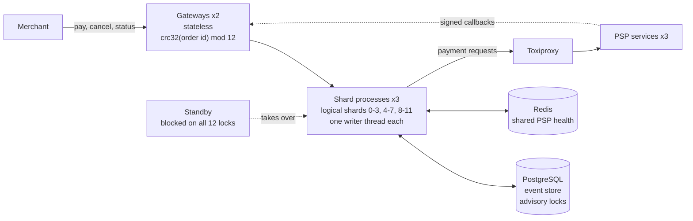
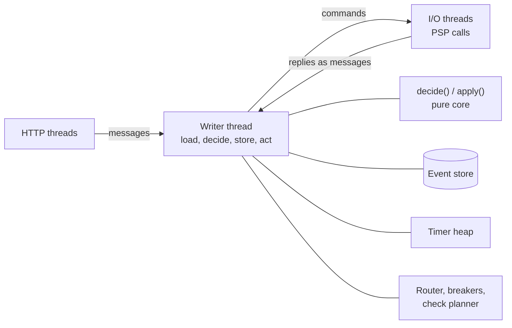
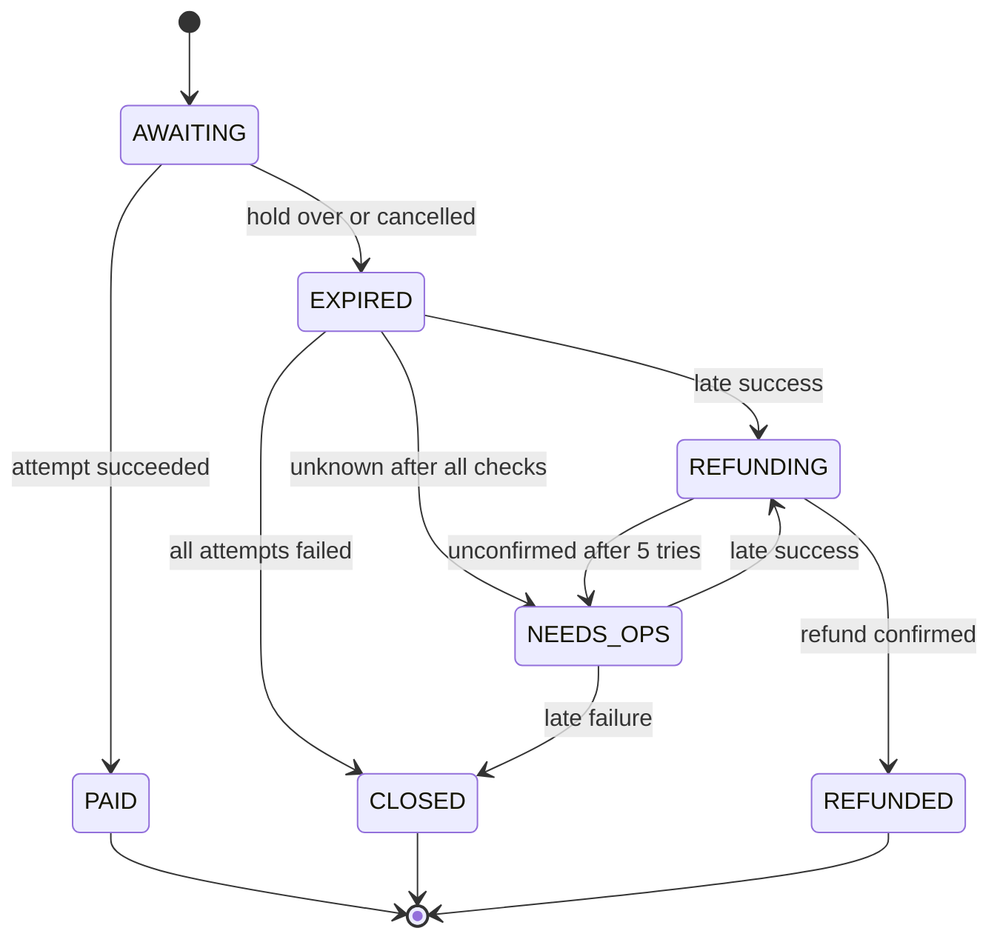

<h1 align="center">Settle</h1>

<p align="center">
  <b>Fault-tolerant UPI payment orchestration.</b><br>
  Every order ends paid exactly once, or not charged at all, inside NPCI's rules.
</p>

<p align="center">
  <a href="https://github.com/SrijaMalhar/Settle/actions/workflows/ci.yml"></a>
  <a href="https://github.com/SrijaMalhar/Settle/actions/workflows/system.yml"></a>
  
  
  
  
</p>

<p align="center">
  <a href="https://srijamalhar.github.io/Settle/"><b>Open the live demo</b></a>: the real engine, running in your browser. Take a PSP down, crash Settle, plant a bug, and watch the invariants hold or catch it.
</p>

<p align="center">
  
</p>

Settle sits between a merchant and its UPI payment service providers (PSPs). It routes each payment to the PSP most likely to answer cleanly, resolves "pending" payments with status checks inside NPCI's limits, and refunds automatically when money arrives after an order was given up. It runs as a sharded, event-sourced service with a hot standby, and every code change is tested on the full Docker deployment under real faults.

| | |
|---|---|
| **Correctness** | 10,000 simulated runs, 400,000 orders, 8,804 injected crashes: **0 invariant violations** |
| **Failover** | standby serving **0.33 s** after `docker kill`, with **0 failed requests** |
| **Scaling** | **1.97x** throughput at 2 shards, **2.79x** at 3, on a fixed CPU budget per shard |
| **Chaos** | 6 fault scenarios on every code change: **0 invariant violations** |
| **Tests** | 129, against real PostgreSQL, Redis and Toxiproxy; `mypy --strict` |

[Why it's hard](#why-its-hard) · [Architecture](#architecture) · [Payment lifecycle](#payment-lifecycle) · [Observability](#observability) · [Results](#results) · [Getting started](#getting-started) · [API](#api) · [Project structure](#project-structure)

## Why it's hard

A UPI payment can sit at "pending" while nobody knows whether money left the customer's account.

- **A timeout proves nothing.** The PSP may have the request, so retrying elsewhere can charge twice.
- **Answers arrive late, twice or never.** Callbacks get lost, repeated, or beat the HTTP reply.
- **Status checks are rationed.** NPCI allows three: the first after 90 s, at least 90 s apart, within two hours.
- **Orders expire.** Money that arrives after the order was given up must go back.

| Guarantee | How |
|---|---|
| No order is charged twice | One live attempt per order; a timeout is "unknown", checked and never resent |
| An unpaid order ends with no money taken | A late success becomes a refund, retried with the same id until confirmed |
| NPCI's check rules always hold | Every check plan is fitted to the rules before it is scheduled |
| A crash loses nothing and repeats nothing | Events are stored before any command runs |
| One writer per shard | A PostgreSQL advisory lock per logical shard, held by the connection that writes |

## Architecture



Gateways hash each order to one of 12 logical shards and forward it to the process holding that shard's lock. A standby waits on all 12 locks: when an owner dies, its database session ends, the lock frees, and the standby rebuilds open payments from events and takes over. Endpoints are idempotent, so a request that hits a dead owner is simply sent again.

### Inside a shard



Each shard process is an actor: one writer thread owns all payment state, and other threads only exchange messages with it. Every business rule lives in one pure function:

```python
decide(payment, input) -> (events, commands)   # no I/O, no clock, no randomness
apply(payment, event)  -> payment              # state is a fold over stored events
```

The writer stores the events in one transaction, then runs the commands. Time and the router's choice arrive with the input, so the same rules run unchanged in production, the simulator and replay.

## Payment lifecycle



A definite failure keeps the payment in `AWAITING` so the customer can pay again; a PSP that contradicts itself sends it to `NEEDS_OPS`. Both state machines are transition tables in [`model.py`](settle/core/model.py), and any move not in them raises.

**Routing.** Failures are blamed by NPCI response code: a wrong PIN (`ZM`) is the customer's, an acquirer timeout (`BT`) is the PSP's, and only the PSP's own count against it. The router picks a PSP by Thompson sampling over the last minute of outcomes, shared through Redis, and counts a success that left the customer at "pending" as half a success. That cut pending payments **4.9x** for 1.8% fewer eventual successes. A circuit breaker per PSP opens after five PSP-side failures in a row.

**Status checks.** An order moves to another PSP only when the first provably never received the request; Toxiproxy showed that slow and reset requests do reach the PSP. Anything else gets up to three checks, timed from that PSP's answer-time percentiles. On a slow PSP this resolved **88.5%** of lost callbacks, against 79.4% for fixed timing.

## Observability

<p align="center">
  
</p>
<p align="center"><sub>Captured by CI immediately after the chaos runs: traffic leaving a slowed PSP, breakers opening, checks following pending spikes, and ownership moving when a shard is killed.</sub></p>

Shards and gateways export Prometheus metrics, and Grafana loads a provisioned dashboard. Five alert rules ship with it; the one for a shard without an owner fired 21 s after a shard was killed with no standby running.

## Results

The [`system`](.github/workflows/system.yml) workflow runs on every code change: it builds the images, starts the stack on a 4-vCPU runner, injects faults, and checks every payment against each mock PSP's own ledger. Raw output is in [`results/`](results/).

| Test | Result |
|---|---|
| Simulator: 10,000 seeds of lost callbacks, network faults and crashes | **0 invariant violations**; 300 of 300 seeds re-run identically |
| 7 classic payment bugs planted behind flags | **all 7 caught** |
| Shard owner killed with `SIGKILL` | standby took the lock in **2.2 ms** |
| Every stored history replayed through `decide()` | **5,195 of 5,195** rebuilt exactly |

**Chaos**, at 30 payments/s, one 20-second fault per run:

| Fault | Result |
|---|---|
| PSP slowed to 5 s | its share of new attempts fell to 0; all 92 unknown attempts resolved |
| PSP down | breaker open on every shard in **0.03 s**; 0 errors |
| Connection resets | all 38 unknown attempts resolved; none sent twice |
| `docker kill` a shard | standby serving in **0.33 s**; **0 errors** |
| `docker pause` a shard | its own customers waited or were shed; **other shards 0 errors**, p95 9.3 ms |
| Redis stopped | **0 errors**, p95 9.9 ms |

After all six, each of the 5,195 payments was charged exactly when it was paid.

**Load**, with each shard process held to 0.5 CPU:

| Shard processes | Payments/s | Scaling |
|---|---|---|
| 1 | 72 | 1.00x |
| 2 | 142 | **1.97x** |
| 3 | 202 | **2.79x** |

Shards share nothing, so capacity grows almost linearly until the host runs out of CPU.

## Getting started

Requires Docker with Compose v2; Python 3.12 only for the tests and tools.

```bash
docker compose up -d --build

KEY='authorization: Bearer dev-merchant-key'
curl -X POST localhost:8000/orders/order-1/pay -H "$KEY" -H 'content-type: application/json' -d '{"amount": 49900}'
curl -H "$KEY" localhost:8001/orders/order-1     # any gateway serves any order
```

Gateways run on `:8000` and `:8001`, Grafana on `:3000`, Prometheus on `:9090`.

The [live demo](https://srijamalhar.github.io/Settle/) needs no install: a Web Worker runs `settle/` and `sim/live.py` on CPython compiled to WebAssembly. `python scripts/build_demo.py` builds it, and the `demo` workflow publishes it after `scripts/demo_smoke.py` boots it in Chromium, switches every fault on and plants a bug.

```bash
pip install -e ".[dev,load]"
mypy && pytest                       # starts throwaway PostgreSQL, Redis, Toxiproxy if installed
python scripts/demo.py               # the three payments above
python -m sim.run seeds --count 10000
python -m chaos.run_all              # needs the stack, started with SETTLE_HOLD_SECONDS=60
python -m loadtest.run --shard-cpus 0.5
```

## API

Merchant endpoints take `Authorization: Bearer <key>`; PSP callbacks are HMAC-signed.

| Method | Path | |
|---|---|---|
| `POST` | `/orders/{id}/pay` | Create the payment or start a new attempt; `409` while an earlier attempt may still succeed |
| `POST` | `/orders/{id}/cancel` | Give up the order; a later success is refunded |
| `GET` | `/orders/{id}` | Status, attempts, refunds, next status check |
| `POST` | `/psp/{psp}/callback` | Signed PSP result; duplicates are no-ops |
| `GET` | `/stats`, `/metrics` | PSP scores, breakers and ops queue; Prometheus metrics |

## Project structure

```
settle/                     the service
├── core/                   pure domain logic: no I/O, clocks or threads
│   ├── decide.py           decide() and apply(): every business rule
│   ├── model.py            both state machines as transition tables
│   ├── messages.py         inputs, stored events and commands
│   └── money.py            amounts as integer paise
├── policies/
│   ├── routing.py          Thompson-sampling router, failure blame by NPCI code
│   ├── breaker.py          per-PSP circuit breaker on the PSP's own failures
│   └── checks.py           status-check planners within NPCI limits
├── shard/
│   ├── engine.py           writer thread, I/O dispatch, crash recovery
│   ├── ownership.py        advisory-lock ownership and standby takeover
│   ├── timers.py           due checks, expiries and refund retries
│   ├── feeds.py            stored events feeding router, breakers, planner
│   └── server.py           HTTP endpoints, one message per request
├── adapters/
│   ├── postgres_store.py   append-only event store
│   ├── memory_store.py     in-memory store for tests and the simulator
│   ├── redis_health.py     shared PSP health; local_health.py as fallback
│   ├── http_psp.py         PSP client; classify.py: could the PSP have it?
│   └── notifier.py         merchant notifications
├── ports.py                the five interfaces between logic and adapters
├── factory.py              builds stores, PSP clients and engine from settings
├── gateway.py              stateless routing, bulkheads, merchant auth
├── sharding.py             12 logical shards over any number of processes
├── signing.py              HMAC-SHA256 callback signatures
├── replay.py               re-runs stored inputs through decide()
├── metrics.py              Prometheus metrics
└── mockpsp.py              mock PSP: NPCI codes, signed callbacks, true ledger

sim/                        deterministic simulator
├── world.py                customers, truthful PSPs, a lossy network, crashes
├── live.py                 the same world, endless and steered by hand
├── invariants.py           I1 to I7, checked from outside the engine
├── profiles.py             PSP profiles, faults, planted-bug switches
└── run.py                  seeds, determinism, planted bugs, experiments

chaos/
├── run_all.py              six faults on the Docker deployment under load
└── check.py                the invariants over stored events and PSP ledgers

loadtest/                   Locust load at 1, 2 and 3 shard processes
tests/                      129 tests: unit, property, PostgreSQL, Redis, HTTP
deploy/
├── initdb.sql              events, orders, inputs, shard_owners
├── prometheus.yml          scrape targets
├── alerts.yml              alert rules; alerts_test.yml tests them in CI
├── grafana/                provisioned data source and dashboard
├── toxiproxy.json          one proxy per PSP
└── local/                  runs the stack without registry access
demo/                       browser demo: page, and a worker running Pyodide
scripts/                    demo, GIF, demo site build, smoke tests, screenshot
results/                    simulator, chaos, replay and load results as JSON
.github/workflows/
├── ci.yml                  types, tests, 1,000 sim seeds, planted bugs, alerts
├── system.yml              Docker deployment: smoke, chaos, replay, load
└── demo.yml                live demo: build, test in Chromium, publish
```

`settle/core` performs no I/O, so the shard engine, the simulator and the replay check all run the same `decide()`.
